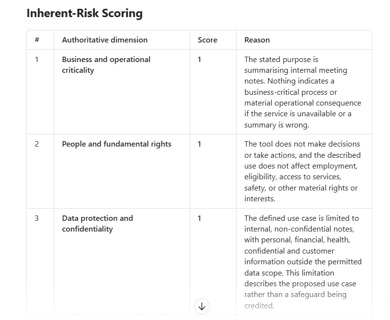
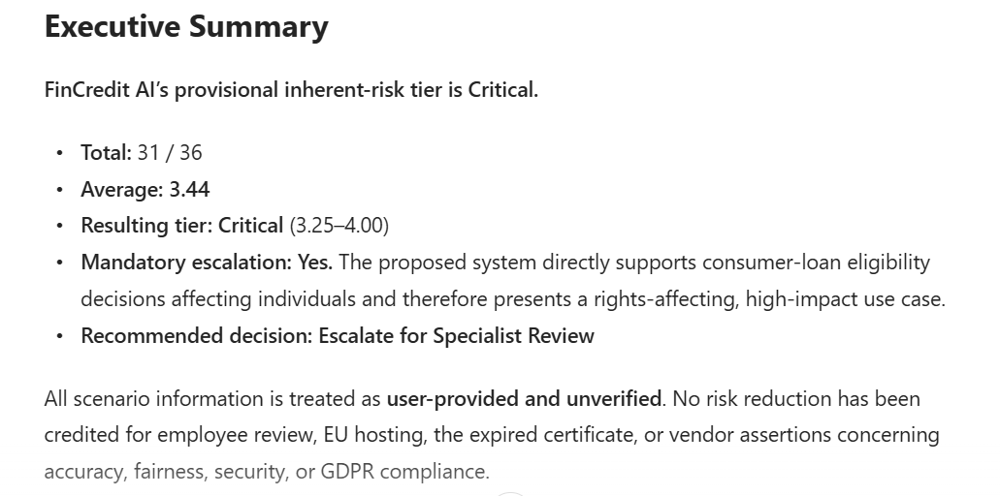
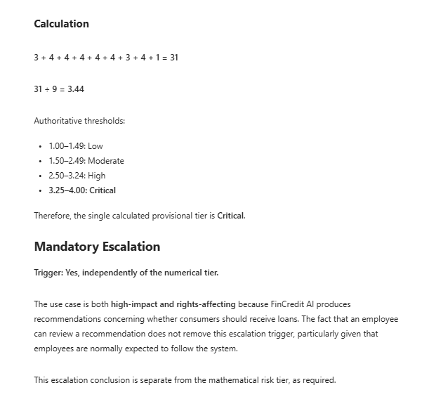
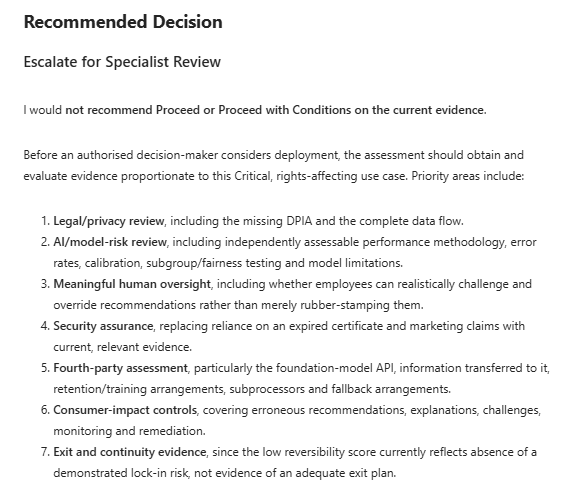

# AI Vendor Assurance Agent

An evidence-aware Microsoft Copilot agent for structured assessment of AI-enabled vendors. The project demonstrates practical AI governance: inherent-risk classification, evidence-gap analysis, third- and fourth-party dependency review, proportionate decision recommendations, and a required final human approval step.

**Related:** the [AI Assurance Toolkit](https://github.com/aderonkethompsonphd/ai-assurance-toolkit) provides questionnaires, scoring and a frontier-developer assurance module. This agent applies a similar evidence-first approach as a human-in-the-loop assistant.

This project was built as a hands-on exercise in AI governance: designing a structured assessment method, testing it, and documenting where it failed.

## Governance problem

Vendor assessments often mix inherent risk with safeguards, treat unverified claims as evidence, or give inconsistent ratings. This agent applies a structured framework while making evidence limitations explicit.

## What the agent does

- captures the proposed use case, affected people, data, autonomy and business impact;
- scores nine authoritative inherent-risk dimensions on a 1–4 scale;
- calculates one provisional tier using fixed thresholds;
- is instructed to separate inherent risk from controls and residual risk;
- distinguishes reviewed evidence from vendor or user assertions;
- identifies missing evidence, control gaps and fourth-party dependencies;
- recommends Proceed, Proceed with Conditions, Escalate for Specialist Review, or Do Not Proceed;
- preserves human accountability for the final decision.

## Risk model

| Dimension | Focus |
|---|---|
| Business and operational criticality | Consequence of error or unavailability |
| People and fundamental rights | Effects on individuals and access to opportunities |
| Data protection and confidentiality | Sensitivity and scale of information |
| Security and misuse | Abuse, compromise and harmful-use potential |
| Autonomy and human oversight | Decision/action authority and meaningful challenge |
| Model performance and transparency | Accuracy, bias, explainability and limitations |
| Third and fourth-party dependency | Vendor, model, infrastructure and subprocessor reliance |
| Regulatory and contractual exposure | Applicable obligations and liability |
| Reversibility and exit | Lock-in, substitution and recovery |

**Formula:** total of nine scores ÷ 9.

| Average | Tier |
|---:|---|
| 1.00–1.49 | Low |
| 1.50–2.49 | Moderate |
| 2.50–3.24 | High |
| 3.25–4.00 | Critical |

Safeguards such as certification, hosting location, contractual terms and human review are not used to reduce the inherent-risk score. Mandatory escalation triggers are assessed separately from the arithmetic result.

## Latest scenario review — 10 October 2026

The latest supplied outputs were reviewed using instruction revision v3. These are three demonstration runs, not evidence of full validation or repeatability.

| Fictional scenario | Total | Average | Tier | Mandatory escalation | Recommendation |
|---|---:|---:|---|---|---|
| NoteAssist: bounded administrative summaries, no actions, easy manual fallback | 16/36 | 1.78 | Moderate | No | Proceed with Conditions |
| Northwind: grid incident summaries/advisories, optional ticketing actions | 26/36 | 2.89 | High | Yes | Escalate for Specialist Review |
| FinCredit: consequential consumer-credit recommendations, weak review | 31/36 | 3.44 | Critical | Yes | Escalate for Specialist Review |

Arithmetic and summary consistency passed in these latest outputs. Recommendations distinguish bounded administrative use from consequential energy and lending use. The outputs distinguish scenario information and claims from reviewed evidence and do not assign residual risk without control evidence.

**Remaining weakness:** some inherent-risk rationales still rely on missing documentation. NoteAssist's regulatory score, FinCredit's regulatory rationale, and Northwind's treatment of ticketing autonomy need further calibration. Scores are provisional, not validated objective measurements.

See [test review and limitations](tests/REVIEW.md) and [original supplied outputs](tests/results/). NoteAssist's full latest output is not included; its reviewed summary is recorded. Existing screenshots show earlier runs and do not prove the latest configuration or results.

### Historical screenshots

Earlier NoteAssist testing produced Low (12/36, 1.33). This is historical, not the latest result.

FinCredit screenshots also predate the latest instruction revision, even where the numerical result matches.

## Evidence discipline

The authoritative knowledge documents use these evidence labels:

- **Verified evidence:** a supplied document, record or test result directly supports the statement; this does not imply an independent audit.
- **Vendor claim:** the vendor asserts a control or capability, but supporting evidence has not been reviewed.
- **User provided information:** supplied by the assessor or business owner; independent verification is pending.
- **Assumption:** a provisional premise, explicitly marked for validation.
- **Missing information:** information needed for a defensible conclusion is unavailable.
- **Not applicable:** outside the documented use case, with a recorded reason.

For supplied evidence, separately describe whether support is complete or partial, including scope, recency and operating-effectiveness limitations. Scenario descriptions are user-provided information, not verified vendor evidence.

Missing vendor evidence can limit confidence and prevent a residual-risk conclusion, but it does not automatically block a provisional inherent-risk assessment when the use case and plausible impacts are sufficiently described.

## Iteration and quality assurance

Testing has exposed arithmetic/tier mismatches, treating missing evidence as risk, and unnecessary escalation of bounded administrative uses. Revisions clarified provisional scoring, evidence labels, separate escalation, conditional approval and human accountability.

In the supplied v2 runs, NoteAssist no longer over-escalated, but Northwind displayed conflicting totals/tiers and a score placeholder. This failed output is retained. The v3 instructions require finalising scores before writing the summary and using consistent totals throughout. The latest three outputs passed calculation and decision checks, but scoring rationale only partially passed. No claim of identical outcomes across repeated v3 runs is made.

## Knowledge files

The agent's knowledge files are in the repository as `.docx`, which are the versions loaded into the agent. Markdown copies are in `docs/` for easy reading and version comparison. The `.docx` files are the source for their Markdown copies. `AGENT_INSTRUCTIONS.md` contains the current runtime dimensions, thresholds, evidence labels and escalation clarifications. Flag any conflict; do not silently apply older, broader escalation rules from knowledge documents. The operating instructions use the same evidence labels as these knowledge documents. The published materials describe an advisory workflow requiring final human approval; this repository does not demonstrate a technical approval gate. The repository includes:

1. `01_AI_Vendor_Assessment_Methodology.docx`
2. `02_AI_Vendor_Risk_Scoring_and_Decision_Rules.docx`
3. `03_AI_Vendor_Evidence_and_Control_Catalogue.docx`

These documents define the assessment workflow, scoring logic, decision rules, evidence expectations and control catalogue used by the agent.

## Instruction revision

`AGENT_INSTRUCTIONS.md` is revision v3, below the 8,000-character limit. Latest outputs were supplied by the author after replacement in Copilot; the deployed configuration was not independently inspected. This repository describes a human-approval requirement, not a demonstrated technical approval gate.

## Limitations and human oversight

The agent provides advisory governance analysis. It does not replace legal, privacy, information-security, model-risk, procurement or regulatory approval. Scores remain provisional until facts and evidence are validated. Material changes in purpose, data, autonomy, affected people, model/provider or integrations require reassessment.

